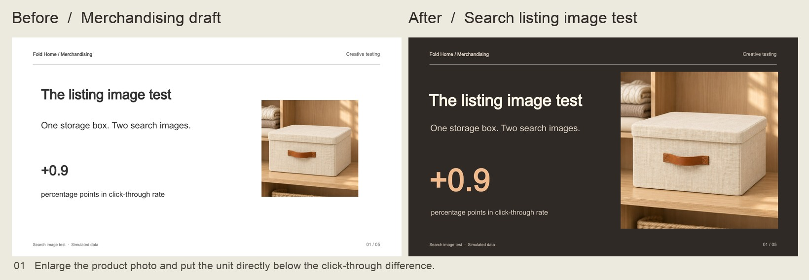

# Slidecraft

[简体中文](README.zh-CN.md)

Create an editable PowerPoint from a brief, or redesign the slides in an existing deck. Slidecraft works as an agent skill for Codex, Claude and WorkBuddy. The offline browser editor lets you try both workflows without installing a skill or entering an API key.

**[User guide](docs/guide.md)** · [Download the offline editor](https://github.com/H8AB/slidecraft/releases/latest/download/slidecraft.html) · [Codex and Claude skill](https://github.com/H8AB/slidecraft/releases/latest/download/slidecraft-agent.zip) · [WorkBuddy skill](https://github.com/H8AB/slidecraft/releases/latest/download/slidecraft-workbuddy.zip)

## Example: Which listing image earns more clicks?



A fictional homeware shop tested two photos of the same storage box. At 20,000 search impressions each, the wardrobe photo drew 900 clicks and the white-background photo drew 720. The wardrobe photo earned more clicks, while both groups converted 5% of clicks into orders. The five-slide review presents the photos, the numbers and the proposed next test.

- **Start from a brief** — [Read the source material](examples/main-image/brief.md) and [download the finished presentation](examples/main-image/01-created.pptx?raw=true).
- **Redesign an existing deck** — Compare the [original draft](examples/main-image/02-before.pptx?raw=true) with the [redesigned presentation](examples/main-image/03-optimized.pptx?raw=true), or [view all five before-and-after pairs](examples/main-image/comparison.jpg).
- **Inspect the work** — Look at the [slide outline](examples/main-image/deck.json), [object-level edit plan](examples/main-image/plan.json) and [verification notes](examples/main-image/verification.md).

## Try it

Download and open **slidecraft.html** in a desktop browser. Under **Create a deck**, select **Load the ecommerce example**, then **Download editable PPTX**. Under **Restyle a deck**, select **Try the ecommerce redesign**, then **Apply plan and download a copy**. English is selected on the first visit. Choose **简体中文** in the header for the Chinese interface and examples.

For agent installation, sample prompts and command-line instructions, see the [user guide](docs/guide.md).

## Editing and compatibility

Create covers, image comparisons, metrics, charts, tables and action slides. When restyling a deck, change the background, text styling and object positions while keeping native slide objects. Signed decks and some slides with animations or embedded objects are available for inspection only. [File formats and limits](skills/slidecraft/references/formats.md)

## Build from source

From the project root, with Node.js 18 or later and Python 3 installed:

```sh
npm ci --prefix skills/slidecraft
node tools/build.cjs
python3 tools/package.py
```

The browser editor and installable skill packages are written to `dist/`. Project code uses the [MIT license](LICENSE). Each distribution includes its dependency notices. The example uses fictional data and [AI-generated product photos](examples/main-image/assets/PROVENANCE.md).
